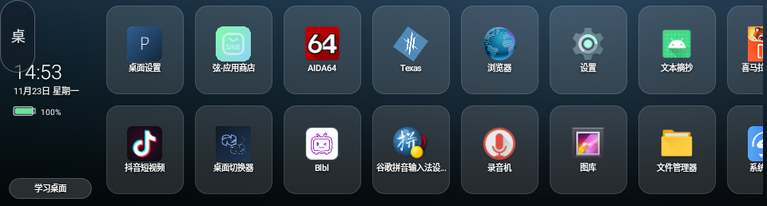

# aerial-pen

基于aerial-tv开发

给低分辨率安卓点读笔（测试机：A20Pro，Android 6.0 / API 23，258×960，density 160）做的第三方桌面。仿 tvOS 风格，纯 Android Framework 自绘，无第三方 UI 库。



## 下载

- Release：https://github.com/Satellite18111/aerial-pen/releases/latest
- 源码克隆：

```bash
git clone https://github.com/Satellite18111/aerial-pen.git
```

## 功能

- 单击应用图标直接进入，不需要长按或二次确认。
- 横竖屏两套自适应布局，针对 258×960 这种特殊比例单独排版：
  - 横屏：左侧时钟列 + 右侧横向卡片；
  - 竖屏：顶部时钟 + 双列卡片。
- 长按应用弹出菜单：应用信息 / 从桌面隐藏 / 恢复隐藏应用 / 刷新列表。
- 左下「学习桌面」胶囊按钮，一键回原厂学王桌面。
- 不占用 `CATEGORY_HOME`，不抢系统默认桌面；按 Home 仍进学王。
- `onResume` 自动刷新应用列表，新装应用无需重启桌面。

| 横屏 | 竖屏 |
| --- | --- |
|  |  |

## 构建

要求：JDK 17+、Android SDK Platform 36/37、Build-Tools 36.0.0。

```bash
./gradlew assembleRelease
```

产物在 `app/build/outputs/apk/release/app-release.apk`（未配置签名时为 `app-release-unsigned.apk`）。

默认构建**未签名**。要出可安装的 release 包，在工程根目录放 `keystore.properties`（已被 `.gitignore` 忽略）：

```properties
storeFile=keystore/release.keystore
storePassword=******
keyAlias=release
keyPassword=******
```

没有该文件时 Gradle 跳过签名配置，仍可正常编译。**不要把 keystore 和口令提交到仓库。**

## 安装

```bash
adb push app-release.apk /data/local/tmp/aerial.apk
adb shell pm install -r /data/local/tmp/aerial.apk
```

部分机器直接 `adb install -r` 会报 `remote Is a directory`，用 `adb push` + `pm install` 更稳。

## 设备适配说明

- 桌面（HOME）方向被系统钉在开机方向；应用内 `setRequestedOrientation` 和 `settings put system user_rotation` 对已在前台的桌面无效，要改桌面方向只能改设置后重启。
- Android 6.0 无 root 时无法 `force-stop` 系统签名桌面，后台清理对 `com.jxw.launcher` 无效。
- 学王桌面是固定磁贴，不显示第三方应用列表；要切换桌面请配合 [pen-desktop-switcher](https://github.com/Satellite18111/pen-desktop-switcher)。

## 鸣谢

视觉方向来自 **Aerial TV**，感谢原作者 **彭楚金（pengchujin）**：

- 项目：https://github.com/pengchujin/aerial-tv
- 许可证：MIT

Aerial TV 面向 Android TV 大屏，提供了「时钟栏 + 横向卡片」的设计语言和交互思路，是本项目最重要的灵感来源。本仓库代码为点读笔重新编写，**没有拷贝或修改上游源码**；屏幕比例、横竖屏布局、长按菜单、隐藏应用、「学习桌面」入口等均为针对 258×960、Android 6.0 的独立实现。

同时感谢 Kotlin 与 Android 开源社区提供的工具链和文档。

## 免责声明

本项目仅供个人学习、技术研究与自有设备个性化使用。下载、安装或使用即视为同意以下条款，完整版本见 [DISCLAIMER.md](DISCLAIMER.md)。

- **不得利用本项目进行任何非法活动。**
- **不得传播恶意软件或病毒。**
- **禁止在微信公众号平台宣传本项目**（为降低法律风险）。
- **禁止利用本项目牟利**；本项目无任何盈利行为，任何第三方收费、代装、广告或打赏均与本项目及作者无关。
- 本项目按「现状」提供，不附带任何担保；改桌面、授权无障碍/悬浮窗、清理后台等操作的风险由使用者自行承担。

本仓库代码由 **豆老师** 编写，以 MIT License 开源。

## 许可证

MIT License，见 [LICENSE](LICENSE)。第三方组件与灵感来源见 [THIRD_PARTY_NOTICES.md](THIRD_PARTY_NOTICES.md)。

## 作者声明
本项目及本页由豆包老师开发和撰写（除了这条），作者仅提供灵感。
