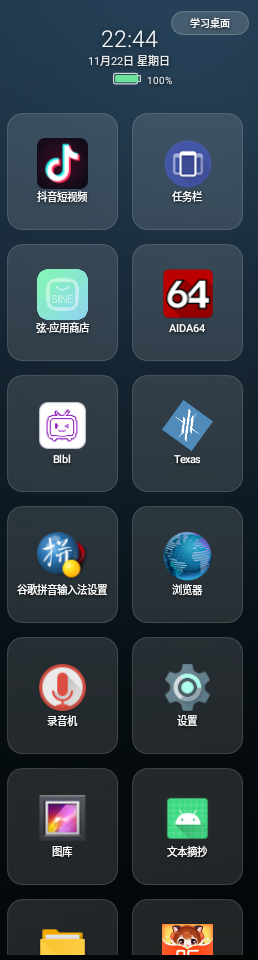
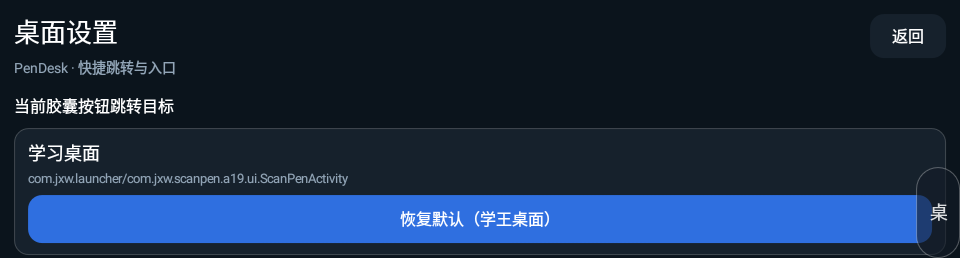
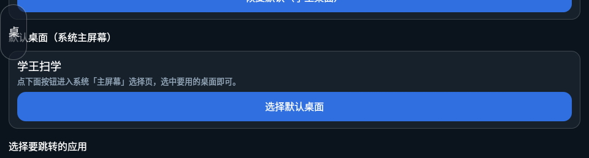

# aerial-pen

受 **Aerial TV** 启发，独立实现。仅参考其视觉语言与交互思路，未拷贝上游源码。

给低分辨率安卓点读笔（测试机：A20Pro，Android 6.0 / API 23，258×960，density 160）做的第三方桌面。仿 tvOS 风格，纯 Android Framework 自绘，无第三方 UI 库。


## 下载

- 官网：https://satellite18111.github.io/aerial-pen/
- Release：https://github.com/Satellite18111/aerial-pen/releases/latest
- 源码克隆：

```bash
git clone https://github.com/Satellite18111/aerial-pen.git
```

## 功能

- 单击应用图标直接进入，不需要长按或二次确认。
- 横竖屏两套自适应布局，针对 258×960 这种特殊比例单独排版：
  - 横屏：左侧时钟列 + 右侧横向卡片；
  - 竖屏：顶部时钟 + 双列卡片。
- 长按应用弹出菜单：应用信息 / 从桌面隐藏 / 恢复隐藏应用 / 刷新列表。
- 桌面内置「桌面设置」入口（应用网格第一格，长按左侧时钟也可进入），可把左下胶囊按钮改成跳转任意已安装应用；默认为原厂学王桌面，支持一键恢复默认。
- 设置里可直接进入系统「主屏幕」选择页，把 Aerial 或学王扫学设为系统默认桌面。
- 左下胶囊按钮文字会跟随所选应用名，宽度自动伸缩，过长自动省略。
- 默认不抢占系统桌面：Aerial 的 HOME 入口默认关闭，只有点「选择默认桌面」时才临时启用；切回学王后再次进入 Aerial 设置会自动关闭该入口。
- `onResume` 自动刷新应用列表，新装应用无需重启桌面。

| 横屏 | 竖屏 |
| --- | --- |
|  |  |

### 桌面设置



- 入口：应用网格第一格「桌面设置」，或长按左侧时钟 → 桌面设置。
- 「当前跳转目标」卡片显示当前应用名称与 `包名/Activity`，可一键恢复默认学王桌面。
- 下方列出设备上所有桌面类（`CATEGORY_HOME`）与可启动应用（`CATEGORY_LAUNCHER`），按中文名称排序；点一下即保存并设为跳转目标。
- 设置保存在 `aerial_pen` SharedPreferences 的 `jump_pkg` / `jump_activity` / `jump_label`，升级安装不会丢。
- 学王桌面即使不在可查询列表中也会被强制补入，保证随时能回默认。

### 默认桌面



- 设置页显示当前系统默认桌面（通过 `CATEGORY_HOME` 解析）。
- 点「选择默认桌面」进入系统自带的「主屏幕」选择页，列表里会同时出现「学王扫学」和「Aerial 桌面」。
- 选中 Aerial 桌面后按 Home 即进入 Aerial；选回学王扫学即恢复原厂桌面。
- Aerial 的 HOME 候选使用 `activity-alias`（`.HomeAlias`），Manifest 里默认 `enabled=false`，不会在安装后自动抢默认桌面。只有点「选择默认桌面」时才启用；如果随后选的不是 Aerial，再进入 Aerial 设置时会自动关闭该候选。
- Android 6 没有 root/device owner 时无法用代码静默改默认桌面，因此必须经过系统「主屏幕」页确认，这是系统限制。

## 构建

要求：JDK 17+、Android SDK Platform 36/37、Build-Tools 36.0.0。

```bash
./gradlew assembleRelease
```

产物在 `app/build/outputs/apk/release/app-release.apk`（未配置签名时为 `app-release-unsigned.apk`）。

默认构建**未签名**。要出可安装的 release 包，在工程根目录放 `keystore.properties`（已被 `.gitignore` 忽略）：

```properties
storeFile=keystore/release.keystore
storePassword=******
keyAlias=release
keyPassword=******
```

没有该文件时 Gradle 跳过签名配置，仍可正常编译。**不要把 keystore 和口令提交到仓库。**

## 安装

```bash
adb push app-release.apk /data/local/tmp/aerial.apk
adb shell pm install -r /data/local/tmp/aerial.apk
```

部分机器直接 `adb install -r` 会报 `remote Is a directory`，用 `adb push` + `pm install` 更稳。

## 设备适配说明

- 桌面（HOME）方向被系统钉在开机方向；应用内 `setRequestedOrientation` 和 `settings put system user_rotation` 对已在前台的桌面无效，要改桌面方向只能改设置后重启。
- Android 6.0 无 root 时无法 `force-stop` 系统签名桌面，后台清理对 `com.jxw.launcher` 无效。
- 学王桌面是固定磁贴，不显示第三方应用列表；要切换桌面请配合 [pen-desktop-switcher](https://github.com/Satellite18111/pen-desktop-switcher)。

## 鸣谢

视觉方向来自 **Aerial TV**，感谢原作者 **彭楚金（pengchujin）**：

- 项目：https://github.com/pengchujin/aerial-tv
- 许可证：MIT

Aerial TV 面向 Android TV 大屏，提供了「时钟栏 + 横向卡片」的设计语言和交互思路，是本项目最重要的灵感来源。本仓库代码为点读笔重新编写，**没有拷贝或修改上游源码**；屏幕比例、横竖屏布局、长按菜单、隐藏应用、「学习桌面」入口等均为针对 258×960、Android 6.0 的独立实现。

同时感谢 Kotlin 与 Android 开源社区提供的工具链和文档。

## 免责声明

本项目仅供个人学习、技术研究与自有设备个性化使用。下载、安装或使用即视为同意以下条款，完整版本见 [DISCLAIMER.md](DISCLAIMER.md)。

- **不得利用本项目进行任何非法活动。**
- **不得传播恶意软件或病毒。**
- **禁止在微信公众号平台宣传本项目**（为降低法律风险）。
- **禁止利用本项目牟利**；本项目无任何盈利行为，任何第三方收费、代装、广告或打赏均与本项目及作者无关。
- 本项目按「现状」提供，不附带任何担保；改桌面、授权无障碍/悬浮窗、清理后台等操作的风险由使用者自行承担。

本仓库代码由 **豆老师** 编写，以 MIT License 开源。

## 许可证

MIT License，见 [LICENSE](LICENSE)。第三方组件与灵感来源见 [THIRD_PARTY_NOTICES.md](THIRD_PARTY_NOTICES.md)。

## 上游许可与边界

Aerial TV 是 **彭楚金（pengchujin）** 以 MIT 许可开源的 Android TV 桌面：

- 项目：https://github.com/pengchujin/aerial-tv
- 许可证：MIT

本仓库与它的关系是 **设计参考，不是代码分支**：

- 没有拉取、拷贝或修改 Aerial TV 的源码；
- 没有打包或复用它的图标、字体、航拍影片、天气数据等上游素材；
- 本项目代码全部为点读笔重新编写，仅参考「时钟栏 + 横向卡片 + 玻璃底板」的视觉语言与长按菜单等交互思路；
- 项目名中的 `Aerial` 用于说明灵感来源，本项目与上游作者无隶属或合作关系。

如果后续引入任何上游源码或素材，会按上游 MIT 许可保留版权声明并在 `THIRD_PARTY_NOTICES.md` 中列明。

## 作者声明
本项目及本页由豆包老师开发和撰写（除了这条），作者仅提供灵感。
